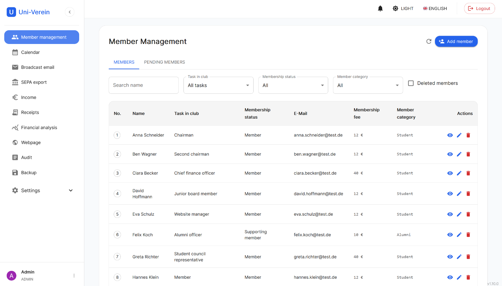

<div align="center">

# Uni-verein

### Open Source club management software for university associations

[](LICENSE)
[](https://github.com/uni-verein/uni-verein/releases/latest)
[](https://github.com/uni-verein/uni-verein/actions/workflows/ci.yml)
[](https://github.com/uni-verein/uni-verein/issues)
[](https://github.com/uni-verein/uni-verein/stargazers)

[**Live Demo**](https://demo.uni-verein.de) &nbsp;·&nbsp; [**Documentation**](https://uni-verein.de/docs/intro) &nbsp;·&nbsp; [**Report a Bug**](https://github.com/uni-verein/uni-verein/issues/new) &nbsp;·&nbsp; [**Request a Feature**](https://github.com/uni-verein/uni-verein/issues/new)

</div>

---

## 📑 Table of Contents

- [About](#-about)
- [Features](#-features)
- [Screenshots](#-screenshots)
- [Demo](#-demo)
- [Getting Started](#-getting-started)
- [Usage](#-usage)
- [Contributing](#-contributing)
- [Roadmap](#-roadmap)
- [License](#-license)
- [Contact](#-contact)

---

## 📖 About

**Uni-verein** is a free and open source club management software specifically designed for university associations and student clubs. Whether you run a sports club, a cultural association, or any other student organization — uni-verein helps you manage your members, mails and finances all in one place.

---

## 🌐 Demo

- [Live Uni-Verein Demo](https://demo.uni-verein.de)

## 📸 Screenshots

<div align="center">



</div>

## ✨ Features

### Members

- 👥 **Member Management**: Members with member numbers, categories, membership status and exit date; deleted members are kept and can be restored by admins
- 📥 **CSV Import & Export**: Import members from a CSV file (with an example file and an error report) and export them again
- 📝 **Self-Enrollment**: Public application form with email confirmation (double opt-in), a review queue where applicants are approved or rejected, and optional legal information the applicant has to accept
- 🌐 **Embeddable Form**: Embed the enrollment form on the club's own website with one script tag, restricted to the domains you allow
- 🔗 **External Links**: Add links to other tools (e.g. a cloud folder) to the menu

### Finance

- 💰 **Membership Fees**: Contribution plans, automatically generated fees, paid/open status, payment dates and stable booking numbers
- 🏦 **SEPA Direct Debit**: Export the fees as a `pain.008.001.08` file (EPC SDD Core), with the club's bank details and creditor ID
- 💶 **Income**: Further income besides the fees, sorted into configurable income categories
- 🧾 **Receipts**: Members submit receipts as photos or PDFs. Amount and date are read on the device by OCR (no upload to a third party), and financial managers review the receipts and mark them as paid. Receipt categories and notifications are configurable
- 📄 **Payment Acknowledgements**: PDF acknowledgement with a consecutive number for every paid fee or income
- 📊 **Finance Analytics**: Compare income and expenses by month and category
- 📑 **EÜR Export**: Income-surplus statement as a spreadsheet with journal and tax-area checks

### Communication

- 📧 **Email**: Send mails to all members or to a member category with a rich text editor and watch the progress live. The SMTP/IMAP settings enforce encryption and offer a test mail
- 📅 **Calendar**: Plan events together, invite members, repeat events, set reminders, subscribe via webcal and publish a public club calendar
- 🔔 **Notifications**: In-app bell and email for calendar events, new self-enrollments, new receipts and new versions (every user chooses what they get)

### Security & Administration

- 🔐 **Role-Based Access Control**: Roles Admin, Financial Manager and User
- 🛡️ **Two-Factor Authentication**: TOTP with QR code and recovery codes, login lockout, rate limits and a mail when someone logs in from a new device
- 🗒️ **Audit Log**: Traceable changes to users, finances, settings and backups
- 💾 **Backup & Restore**: Download a full backup (database and receipt files) and restore it from the web interface
- 🚀 **First-Time Setup**: Guided creation of the first administrator, protected by a setup token
- 🔄 **Update Hints**: The app checks for new releases and notifies admins

### Usability

- 📱 **Installable App**: Progressive web app with a mobile layout, bottom navigation and offline-capable app shell
- 🌙 **Dark Mode**: Follows the system or can be switched manually
- 🌍 **Multi-language Support**: Available in multiple languages (currently DE, EN)
- 🧪 **Demo Mode**: Resets itself with sample data, as used by the [live demo](https://demo.uni-verein.de)

---

## 🚀 Getting Started

### Prerequisites

Make sure you have the following installed:

- [Docker & docker compose](https://docs.docker.com/compose/install/)

### Installation

Choose one of the two options below depending on whether something in front
of this stack already terminates TLS for you (a cloud load balancer,
Cloudflare Tunnel, an existing reverse proxy on the host, etc.).

#### Option A: TLS included (recommended)

Use this unless you already terminate TLS in front of this stack.

**Additional prerequisites:**

- A domain name with a DNS A/AAAA record already pointing at this server's
  public IP.
- Ports `80` and `443` reachable from the internet (check your firewall,
  cloud security group, and router port forwarding). Port 80 is required
  even for HTTPS — it's used for certificate issuance and to redirect
  plain-HTTP visitors to HTTPS.

1. **Download config & installation files**

```bash
curl -O https://raw.githubusercontent.com/uni-verein/uni-verein/refs/tags/1.11.0/nginx.conf
curl -O https://raw.githubusercontent.com/uni-verein/uni-verein/refs/tags/1.11.0/Caddyfile
curl -O https://raw.githubusercontent.com/uni-verein/uni-verein/refs/tags/1.11.0/docker-compose-ini.yml
curl -O https://raw.githubusercontent.com/uni-verein/uni-verein/refs/tags/1.11.0/docker-compose-tls.yml
```

2. **Create .env and secrets**

```bash
touch .env && mkdir backup && docker compose -f docker-compose-ini.yml up
```

Edit the `.env` file, change database secrets, and set your domain:

```env
DB_ROOT_PASSWORD=rootUserPassword
DB_NAME=uni-verein
DB_USER=databaseUserName
DB_PASSWORD=databaseUserPassword
DOMAIN=club.example.org
ACME_EMAIL=admin@example.org
```

3. **Start application**

```bash
docker compose -f docker-compose-tls.yml up -d
```

The application will be available at `https://<your-domain>` 🎉 A
certificate is requested automatically on first start, this can take up to
a minute, and it needs your DNS record and ports 80/443 already in place. If
it doesn't come up, check `docker compose -f docker-compose-tls.yml logs caddy`.

<details>
<summary><h4>Option B: TLS already terminated in front of this stack</h4></summary>

> ⚠️ **Only use this if you have already set up TLS in front of this
> stack.** This path serves plain HTTP with no encryption of its own
> exposing it directly to the internet sends login credentials, session
> tokens, and member data (including IBANs) in the clear.

1. **Download config & installation files**

```bash
curl -O https://raw.githubusercontent.com/uni-verein/uni-verein/refs/tags/1.11.0/nginx.conf
curl -O https://raw.githubusercontent.com/uni-verein/uni-verein/refs/tags/1.11.0/docker-compose-ini.yml
curl -O https://raw.githubusercontent.com/uni-verein/uni-verein/refs/tags/1.11.0/docker-compose-prod-image.yml
```

2. **Create .env and secrets**

```bash
touch .env && mkdir backup && docker compose -f docker-compose-ini.yml up
```

Edit the `.env` file and change database secrets:

```env
DB_ROOT_PASSWORD=rootUserPassword
DB_NAME=uni-verein
DB_USER=databaseUserName
DB_PASSWORD=databaseUserPassword
```

3. **Tell the stack about your reverse proxy**

The login lockout, the rate limits and the IP shown for self-enrollments work
per visitor address. This stack only sees the address of your proxy, so it must
learn the visitor address from the `X-Forwarded-For` header, and it believes that
header **only from proxies you list**. Without this step every visitor looks like
the proxy: all users share one login lockout (three wrong passwords of anyone lock
the account for everybody) and one rate limit.

On the machine that runs this stack, create the folder `trusted-proxies` next to
the compose file and put the address of your proxy (the address this stack sees
the requests coming from; IPv6 and networks like `192.168.1.0/24` work too) into
a `.conf` file in it:

```bash
mkdir -p trusted-proxies
echo "set_real_ip_from <address of your proxy (192.168.1.20)>;" > trusted-proxies/proxy.conf
```

Your proxy has to **overwrite** the header with the address of the visitor and
must not pass on what the visitor sent. With nginx as the proxy:

```nginx
location / {
    proxy_pass http://<address of this stack>:80;
    proxy_set_header Host $host;
    proxy_set_header X-Forwarded-For $remote_addr;
}
```

Other proxies (Traefik, Nginx Proxy Manager, Apache, ...) set the header on their
own, check that it contains the visitor address. Only the proxy may be able to
reach this stack: block port 80 for all other machines with a firewall, otherwise
they can send the header themselves and choose any address.

To check it, open the application from outside and look at the log of the proxy
container (`docker compose -f docker-compose-prod-image.yml logs proxy`): it
must show your own address and not the one of your proxy. Restart the proxy
container after changing the folder (`docker compose -f docker-compose-prod-image.yml restart proxy`).

> The folder is not touched by updates. Older versions trusted every address in
> `172.16.0.0/12` (the default Docker range) as a proxy. If your proxy was
> covered by that, create the file once when you update, otherwise the visitor
> address is lost. The TLS-included setup (option A) needs nothing.

4. **Start application**

```bash
docker compose -f docker-compose-prod-image.yml up -d
```

The application will be available at `http://localhost:80` 🎉

</details>

---

### Updating

As an admin, you'll see a notification bell in the app once a new version is available. Before updating, create a manual backup (database backup and member export, both available under Settings → Backup in the app). Then run this from your installation directory (the one containing `.env`):

```bash
curl -O https://raw.githubusercontent.com/uni-verein/uni-verein/main/docker-compose-update.yml
docker compose -f docker-compose-update.yml run --rm update
```

It checks GitHub for the latest release and asks you to confirm that you've created a manual backup, the update only proceeds once you type `yes`. It then downloads the matching `nginx.conf` and whichever compose file your installation uses (`docker-compose-tls.yml`, plus its `Caddyfile`, if you installed with TLS included; otherwise `docker-compose-prod-image.yml`), updates `VERSION` in your `.env`, and restarts the stack on the new version. Your existing secrets and database are left untouched. If you're on the TLS-included setup, note that `Caddyfile` is overwritten on every update just like `nginx.conf` already is, keep any local changes to it (beyond `DOMAIN`/`ACME_EMAIL`, which live in `.env`) in mind before updating.

> Still on `v1.3.1` or earlier (MariaDB)? Follow the [legacy update](legacy-update/README.md) first.

---

## 🛠️ Usage

A fresh installation has no user account. When you open the application for
the first time it shows the setup page, where you create the first
administrator (user name, email address and password, 10 to 50 characters).

The page asks for a setup token. `docker-compose-ini.yml` prints it as the
last lines of its output and stores it in your `.env` as `SETUP_TOKEN`. It
only protects the first-time setup, so nobody who reaches a new server before
you can take it over. After the first account exists, the setup page is gone
and the token has no further use.

For a detailed guide, please refer to our [Documentation](https://uni-verein.de/docs/intro).


## 🤝 Contributing

Contributions are what make the open source community such an amazing place to learn, inspire, and create. Any contributions you make are **greatly appreciated**!

1. Fork the project
2. Create your feature branch (`git checkout -b feature/AmazingFeature`)
3. Commit your changes (`git commit -m 'Add some AmazingFeature'`)
4. Push to the branch (`git push origin feature/AmazingFeature`)
5. Open a Pull Request

Please read our [CONTRIBUTING.md](CONTRIBUTING.md) for details on our code of conduct and the process for submitting pull requests.

---

## 🗺️ Roadmap

- [ ] File management
- [ ] Chat system
- [ ] Multi-Tenant-Support

---

## 📜 License

Distributed under the **[Apache-2.0 license](LICENSE)**. See [`LICENSE`](LICENSE) for more information.

---

## 📬 Contact

**Uni-verein Team**

- GitHub: [@uni-verein](https://github.com/uni-verein)
- Website: [uni-verein.de](https://uni-verein.de)
- LinkedIn: [René Herrmann](https://de.linkedin.com/in/rené-herrmann-aa2204199)

---
